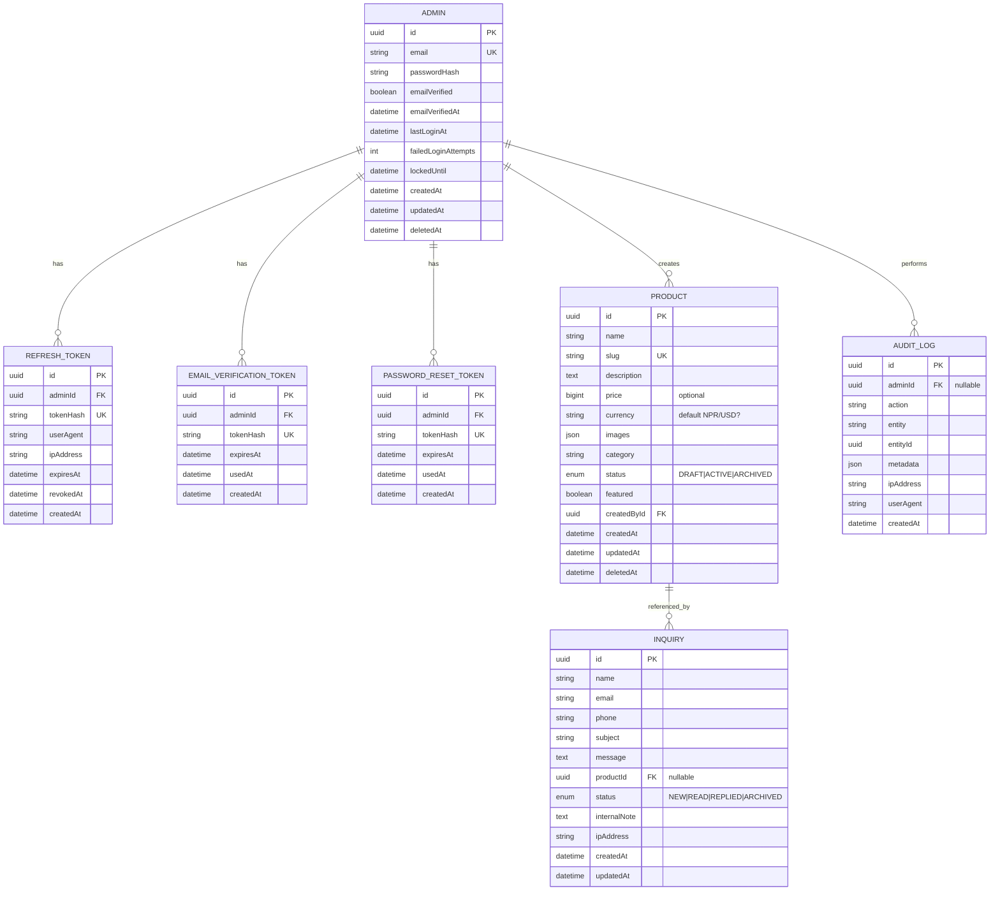

# Plan: Production-Ready NestJS Backend for Marketing & Contact Website

## Overview
Build a production-ready, scalable backend API for PashupatiPlasto (marketing + contact website) using NestJS, TypeScript strict, PostgreSQL, Prisma, JWT auth for admins only, Resend email, etc. Frontend is separate React app; public visitors never log in.

## 1) Architecture Proposal (to confirm)

### Folder structure (target)
```
backend/
├── src/
│   ├── main.ts
│   ├── app.module.ts
│   ├── config/           # env validation + typed config (zod/class-validator)
│   ├── common/           # decorators (@Public, @Roles), guards, filters, interceptors, pipes, dto base, utils
│   ├── database/         # PrismaService, prisma module, migrations, seeds
│   ├── modules/
│   │   ├── auth/         # login/logout/refresh/me, verification, password reset, strategies/guards
│   │   ├── admins/       # admin profile management
│   │   ├── products/     # CRUD + public listing/detail
│   │   ├── inquiries/    # public submit + admin mgmt + spam protection
│   │   ├── mail/         # MailService interface + Resend impl + templates (html/text)
│   │   └── health/       # terminus health check
├── prisma/
│   ├── schema.prisma
│   └── migrations/
├── test/                 # e2e tests
├── docker-compose.yml
├── Dockerfile
├── .env.example
├── README.md
├── ARCHITECTURE.md
└── openapi.json (exported)
```

### ER Diagram (proposed)


### Key decisions & trade-offs
- **Prisma**: schema migrations, type safety, easy seeding; slight overhead vs raw SQL but acceptable.
- **Argon2** for passwords (better than bcrypt in modern setups). 
- **HttpOnly Secure SameSite cookies** for tokens (CSRF considerations; SameSite Lax/Strict per route, CORS allowlist). 
- **Hashed tokens in DB** (refresh/verification/reset) for revocation/rotation/reuse detection. 
- **Soft delete** for products by default; hard delete admin-only. 
- **Global auth guard + @Public()**: secure-by-default. 
- **MailService interface**: swappable for tests/other providers. 
- **Cache**: @nestjs/cache-manager + Redis-ready; only public product GETs cached with invalidation on mutations. 
- **Rate limiting**: @nestjs/throttler global + per-route stricter for auth/inquiries. 
- **Honeypot + optional Turnstile** behind feature flag for spam. 
- **Audit log** for sensitive admin actions.

### Endpoint list (proposed)
**Auth (public/admin mixed)**
- POST /api/v1/auth/login (public) - creds -> sets httpOnly cookies
- POST /api/v1/auth/logout (auth) - revoke refresh/session
- POST /api/v1/auth/refresh (public with refresh cookie) - rotate
- GET /api/v1/auth/me (auth) - current admin
- POST /api/v1/auth/verify-email (public) - verify token
- POST /api/v1/auth/resend-verification (auth, rate limited) 
- POST /api/v1/auth/forgot-password (public, generic response)
- POST /api/v1/auth/reset-password (public)
- POST /api/v1/auth/change-password (auth)

**Admins**
- GET /api/v1/admins/me (auth)
- PATCH /api/v1/admins/me (auth) 
- (optional invite later)

**Products**
- GET /api/v1/products (public) - paginated/filtered/sorted/search, only ACTIVE
- GET /api/v1/products/:id (public) or /slug/:slug
- GET /api/v1/admin/products (admin) - all statuses
- POST /api/v1/admin/products (admin)
- PATCH /api/v1/admin/products/:id (admin)
- DELETE /api/v1/admin/products/:id (admin) - soft delete
- DELETE /api/v1/admin/products/:id/hard (admin)
- PATCH /api/v1/admin/products/:id/publish (admin)

**Inquiries**
- POST /api/v1/inquiries (public) - rate limited + honeypot + validation
- GET /api/v1/admin/inquiries (admin) - paginated/filter/search
- GET /api/v1/admin/inquiries/:id (admin)
- PATCH /api/v1/admin/inquiries/:id/status (admin)
- PATCH /api/v1/admin/inquiries/:id/note (admin)
- DELETE /api/v1/admin/inquiries/:id (admin)

**Health**
- GET /api/v1/health

### Clarifying questions (ask user)
1. **Currency/price**: Is price required? If marketing site only, maybe optional; default currency (NPR, USD, etc.)?
2. **Product images**: Store URLs only as specified, or need upload (S3/local)? Spec says "array of URLs for now" so URLs only.
3. **Admin roles**: Just ADMIN now - confirm no other roles needed.
4. **Email delivery**: Use Resend sandbox restrictions - confirm sending domain strategy? 
5. **CORS/frontend origin**: Exact origin for cookies (httpOnly) - confirm FRONTEND_URL.
6. **Rate limits**: Defaults per route? (login, forgot-password, inquiries)
7. **Turnstile/hCaptcha**: Implement behind flag now or skip?
8. **Redis**: Required for cache in docker-compose or optional? "Redis-ready" - include service?
9. **Session storage**: Cookies only, or also allow Bearer tokens? Spec says cookies.
10. **First admin seed**: From env ADMIN_EMAIL/PASSWORD - confirm requirements.

(Will ask top 5 relevant ones.)

## 2) Implementation Phases

### Phase (a) Scaffold, config, Docker, DB
- [x] Init NestJS app structure, strict TS
- [x] Config module with env validation (class-validator/zod)
- [x] .env.example with all vars
- [x] Dockerfile (multi-stage) + docker-compose.yml (Postgres, API, Redis optional)
- [x] Prisma setup, schema.prisma with all models, migrations
- [x] Database module/PrismaService
- [x] Common module: decorators (@Public, @Roles), base filters/interceptors/pipes
- [x] Global ValidationPipe, exception filter, helmet, compression, CORS
- [x] Health module with Terminus + DB ping
- [x] Logging (nestjs-pino) with request IDs

### Phase (b) Admin auth + tokens + tests
- [x] Admins module
- [x] Auth module: strategies (JWT access), guards (JwtAuthGuard global, RolesGuard), services
- [x] Argon2 password hashing
- [x] Token service: access (15min), refresh (7d) hashed in DB, rotation + reuse detection
- [x] HttpOnly Secure SameSite cookies
- [x] Endpoints: login, logout, refresh, me
- [x] Brute force: rate limiting + account lockout
- [x] Generic errors (no email enumeration)
- [x] Unit + e2e tests

### Phase (c) Mail, verification, password reset
- [x] Mail module with MailService interface
- [x] Resend implementation
- [x] HTML + text templates
- [x] Email verification flow (24h, single-use hashed)
- [x] Resend verification (rate limited)
- [x] Forgot password (generic response)
- [x] Reset password (invalidate token, revoke refresh tokens)
- [x] Change password (require current)
- [x] Error handling/logging
- [x] Tests with mocked Resend

### Phase (d) Products CRUD + public listing + caching
- [x] Products module (service/repo/controller)
- [x] DTOs, validation
- [x] Public GET list/detail (only ACTIVE, non-deleted) with pagination/filter/sort/search
- [x] Admin CRUD, publish/unpublish, soft/hard delete
- [x] DB indexes
- [x] Cache layer (@nestjs/cache-manager) for public GETs, invalidation
- [x] ETag/Cache-Control headers
- [x] Tests

### Phase (e) Inquiries + spam protection + notifications
- [ ] Inquiries module
- [ ] Public POST with rate limiting, honeypot, validation, sanitization
- [ ] Optional Turnstile behind flag
- [ ] Save to DB, send admin notification (mail failure doesn't fail submit)
- [ ] Optional auto-confirmation
- [ ] Admin list/view/update status/note/delete
- [ ] Tests

### Phase (f) Hardening, Swagger, CI, docs
- [ ] Swagger at /api/docs, export openapi.json
- [ ] Audit log for sensitive actions
- [ ] Security headers, limits
- [ ] Linting/formatting, Husky/lint-staged
- [ ] GitHub Actions (lint/test/build)
- [ ] README.md, ARCHITECTURE.md, endpoint table
- [ ] Seed script (first admin verified, ~20 products, few inquiries)
- [ ] Final tests pass

## 3) Deliverables checklist
- [ ] Working code, migrations, seed script
- [ ] Dockerfile, docker-compose.yml
- [ ] .env.example
- [ ] README.md
- [ ] ARCHITECTURE.md
- [ ] Endpoint table
- [ ] openapi.json exported

## 4) Definition of done verification
- [ ] `docker compose up` works (migrations+seed run)
- [ ] Public can browse products/submit inquiries
- [ ] Only verified admin can login
- [ ] Forgot/reset/verification work
- [ ] 401/403 correct, no public registration
- [ ] Pagination/filter/sort/search + indexes
- [ ] Inquiries stored, notify admin, rate limited
- [ ] No hashes/tokens/internal fields in responses
- [ ] All tests pass

## Notes
- Follow REST under /api/v1, DTOs everywhere, whitelist validation
- No circular deps
- Never log secrets/tokens/reset links
- Keep policy in guards/services
- Mail failures must not break inquiry submission
- Refresh token reuse -> revoke session
